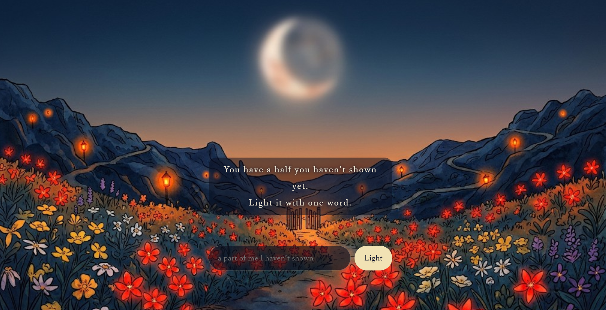

人間の感情というのは非常に複雑で、愛する形も様々です。

愛する。という一言の周りにたくさんの想いがくっついてますね。

愛や喜び、憎しみ　悲しみなど色んな感情が渦巻く。

自分を愛せない日もあるし、自分を愛せる日もある。そんな日々を繰り返し人生を紡いでいきます。

何が正しいかどうかなんて正解はありません。

それぞれの手の中に　選択はゆだねられています。

波のように揺れたり変化する感情を表現シてみようと思いました。

個人的な事から発想が出たのですが、自身の誕生石がカーネリアンですので、カーネリアンの赤色をイメージして花を描き、自身も愛することを表現してみました。
カーネリアンについてお伝えさせてくださいませ

•石言葉　　　成功、勝利、勇気、積極性、深い友情
• 別名: 「勇気の石」「指導者の石」「幸運を呼ぶ石」「情熱の石」

効果

• 行動力・活力の向上: 気持ちを前向きにし、新しい挑戦や目標達成への後押しをする。
• 仕事運・成功: 集中力を高め、ビジネスや試験など勝負どころでの成功を支える。
• 人間関係・円満

