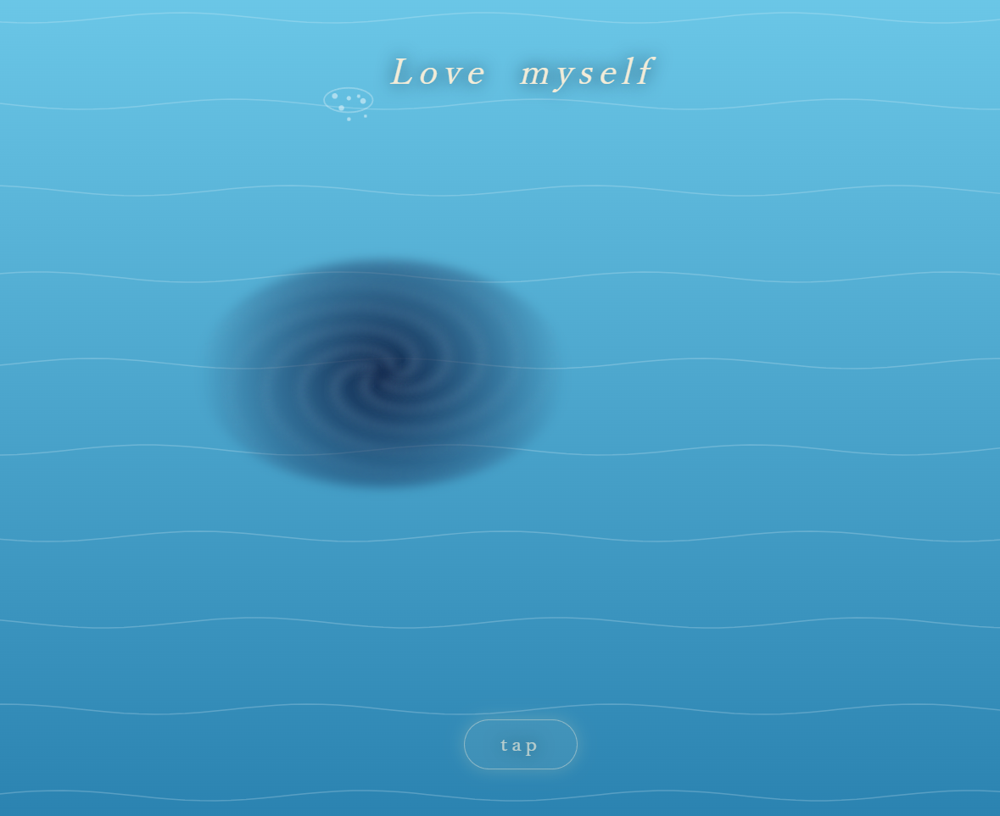

人間の感情というのは非常に複雑で、愛する形も様々です。

愛する。という一言の周りにたくさんの想いがくっついてますね。

愛や喜び、憎しみ　悲しみなど色んな感情が渦巻く。

自分を愛せない日もあるし、自分を愛せる日もある。そんな日々を繰り返し人生を紡いでいきます。

何が正しいかどうかなんて正解はありません。

それぞれの手の中に　選択はゆだねられています。

感情を表現してみようと思いました。

虹の使者イリスは、ギリシア神話（紀元前１８世紀頃）の中では　最も静かに不可欠な存在の一人だったと言われているそうです。
女神さまでもいいし　他の何かを想像してもらってもいいように癒されるイメージを表現してみました。

何も書きたくない場合は、lightボタンをお好きなタイミングで押してください。次の画面にいきます。

このアプリで入力した言葉は、あなたの端末の画面に表示されるだけです。サーバーへの送信も保存もしていないので、ページを閉じると消えます。名前や連絡先などは書かずに、心に浮かんだ一言だけを入れてください。次に　lightボタンを押してください。

https://iris-selflove-sanctuary.lovable.app

## 個人情報について

このアプリは、安心してお使いいただけるように作っています。

- 名前、メールアドレスなどの登録は一切ありません
- 入力した言葉は、画面に表示されるだけです
- 入力した内容は、外部のサーバーに送信されません
- 入力した内容は、保存されません。ページを閉じる、または「Again」を押すと消えます
- Cookieや広告、アクセス解析は使っていません

心に浮かんだ言葉を、安心して灯してください。
なお、住所や電話番号など、個人が特定される情報は入力しないでください。

